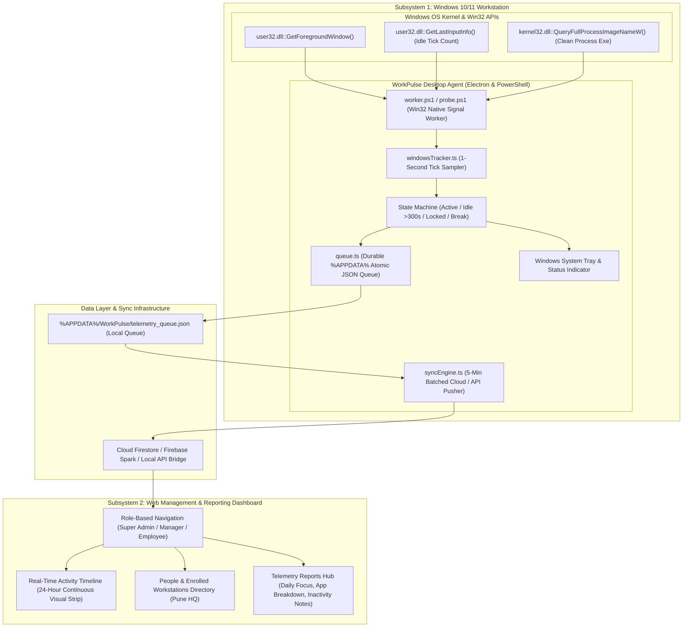

# GA-Work-Time (WorkPulse)

> **Autonomous Windows Endpoint Activity Telemetry & Workforce Analytics Platform**  
> Modern enterprise time tracking driven by native desktop telemetry — zero manual timesheets, zero stopwatch timers, zero surveillance overreach.

---

## 1. Product Overview & Philosophy

**GA-Work-Time** (internal code name *WorkPulse*) is an automated employee time-tracking and endpoint activity telemetry platform designed specifically for Windows enterprise environments.

Unlike traditional HR software, manual stopwatch timers, or intrusive spywares, GA-Work-Time operates on a fundamental engineering principle: **Work activity is captured automatically at the endpoint level via native operating system signals, without burdening employees with manual timesheet entry or compromising their personal privacy.**

```
┌────────────────────────────────────────────────────────────────────────┐
│                        CORE PRODUCT PRINCIPLE                          │
│                                                                        │
│   "Computer presence and active foreground focus measure device        │
│    utilization, not surveillance. Employees should never have to       │
│    fill out manual timesheets or start/stop timers."                   │
└────────────────────────────────────────────────────────────────────────┘
```

### 1.1 Non-Negotiable Pillars

1. **Zero Manual Timesheet Burden:** Employees never fill out timesheets, start stopwatch timers, or submit manual clock-ins. Tracking is fully autonomous and tied to workstation presence.
2. **Measurement Over Presumption:** System measures physical mouse/keyboard activity and foreground window focus. It measures device engagement, not intellectual worth.
3. **Strict Privacy by Design (No Surveillance):**
   - 🚫 **Zero Keylogging:** No keystrokes, passwords, or typed text are ever recorded.
   - 🚫 **Zero Content Surveillance:** No emails, messages, clipboard items, or document contents are inspected.
   - 🚫 **Zero Media Surveillance:** No webcam feeds, microphone audio, or desktop screenshot grabs.
   - 🚫 **Zero Location Tracking:** No GPS or physical IP location tracking.
4. **Transparent & Auditable:** Employees have complete visibility into their own telemetry. They can review their daily timelines, view their foreground app usage, and submit offline explanations for legitimate away-from-keyboard tasks (meetings, whiteboarding, calls).
5. **Single Organization Focus (Pune HQ):** Streamlined for Gryphon Technologies Pune branch, eliminating unnecessary multi-tenant and organization-switching clutter.

---

## 2. End-to-End System Architecture

The system consists of two tightly integrated subsystems:



---

## 3. The Two Core Subsystems

### Subsystem 1: The Native Windows Desktop Agent (`desktop-agent/`)

The desktop agent runs quietly in the Windows background, maintaining a sub-1% CPU consumption footprint and ~45MB memory usage.

* **Native Signal Detection:** Utilizes background PowerShell workers (`worker.ps1` / `probe.ps1`) invoking Win32 P/Invoke APIs:
  - `GetForegroundWindow()` + `GetWindowThreadProcessId()`: Identifies active window handle and PID.
  - `QueryFullProcessImageNameW()`: Resolves binary name (`Code.exe`, `chrome.exe`, `slack.exe`).
  - `GetLastInputInfo()`: Calculates milliseconds since last physical user keyboard or mouse input.
* **Autonomous State Machine (1-Second Cadence):**
  - **`ACTIVE`**: Physical input detected within the last 300 seconds (5 min threshold).
  - **`IDLE`**: No physical user input for >300 seconds.
  - **`LOCKED`**: Windows Workstation lock screen active (`lockapp.exe` / `logonui.exe`).
  - **`BREAK`**: User marked break or meal interval.
* **Micro-Interval Consolidation:** Contiguous ticks are compressed into structured `ActivityInterval` records rather than spamming individual seconds.
* **Atomic File System Queuing:** Buffered locally in `%APPDATA%/WorkPulse/telemetry_queue.json` using atomic rename writes to prevent data loss or file corruption during unexpected power cuts or reboots.
* **5-Minute Batched Sync:** Flushes queued intervals every 300 seconds to the cloud/bridge API, operating smoothly even during spotty network connections.

---

### Subsystem 2: The Web Management & Reporting Dashboard (`ga-work-time`)

Built with **React 18 + TypeScript + Vite + Tailwind CSS + Radix UI**, delivering an ultra-clean, minimal, iOS/Linear-clarity enterprise aesthetic.

#### Flat, Minimalist Role-Based Navigation
Navigation is strictly scoped to eliminate clutter and irrelevant pages:

| Role | Navigation Menu Items | Access Scope & Purpose |
| :--- | :--- | :--- |
| **Super Admin** | • Overview (`/dashboard`)<br>• People (`/people/employees`)<br>• Time Tracking (`/time/timeline`)<br>• Reports (`/reports`) | Platform-wide telemetry, enrolled hardware inventory, 24-hr team timelines, org-wide exports |
| **Manager** | • Overview (`/dashboard`)<br>• My Team (`/people/employees`)<br>• Time Tracking (`/time/timeline`)<br>• Reports (`/reports`) | Authorized department/team members, live agent statuses, idle review, team exports |
| **Employee** | • My Activity (`/dashboard`)<br>• My Reports (`/reports`) | Personal tracked hours, today's focus ratio, personal app breakdown, 7-day history, offline notes |

#### Key Views & Capabilities

1. **Dashboard (`/dashboard`):**
   - **For Super Admin / Manager:** Real-time online agent counts, total tracked fleet hours, fleet focus ratios, and live endpoint status table.
   - **For Employee:** "My Activity" featuring today's tracked hours, active focus duration, idle inactivity, live foreground application, and 7-day historical focus bar.
2. **People & Workstations Directory (`/people/employees`):**
   - Clean hardware inventory showing assigned Windows 10/11 endpoints (e.g. `DESKTOP-AJAYP`, `LAPTOP-ANANYA`), OS builds, agent version, live status (`Active`, `Idle`, `Offline`), and 1-click jump to their 24-hr timeline.
3. **Time Tracking Activity Timeline (`/time/timeline`):**
   - Interactive 24-hour continuous timeline strip broken into 15-minute segments.
   - Color-coded: Emerald (Active focus), Amber (Idle >5m), Slate (Locked/Offline).
   - Filter by employee, state, or zoom into specific hours of the day.
4. **Reports Hub (`/reports`):**
   - **For Employee ("My Reports"):** Personal 4-card telemetry KPI header, 7-day daily time logs with visual active-vs-idle distribution bars, personal app usage distribution, and an **"Explain Inactivity"** modal to submit offline notes for legitimate away-from-keyboard tasks (meetings, whiteboarding).
   - **For Admin / Manager ("Telemetry & Time Reports"):** Platform-wide daily time summaries, fleet-wide application utilization, workstation health inventory, and instant CSV exports.

---

## 4. Telemetry Data Schemas

### 4.1 Activity Interval (`ActivityInterval`)
```typescript
export interface ActivityInterval {
  intervalId: string;
  employeeId: string;
  deviceId: string;
  startTime: string;      // ISO 8601 UTC
  endTime: string;        // ISO 8601 UTC
  durationSeconds: number;
  state: "ACTIVE" | "IDLE" | "LOCKED" | "BREAK";
  executableName?: string;// e.g. "Code.exe", "chrome.exe"
  windowTitle?: string;   // Sanitized foreground window title
  category?: "work" | "neutral" | "unproductive" | "restricted";
  inactivityReason?: string; // Offline explanation submitted by user
}
```

### 4.2 Daily Summary (`DailySummary`)
```typescript
export interface DailySummary {
  summaryId: string;
  employeeId: string;
  deviceId: string;
  localDate: string;       // Format: YYYY-MM-DD
  observedSessionSeconds: number;
  activeComputerSeconds: number;
  idleSeconds: number;
  lockedSeconds: number;
  focusRatio: string;      // e.g. "87%"
  topApp: string;          // e.g. "Visual Studio Code"
  status: "In Progress" | "Full Shift" | "Partial Shift";
  inactivityNote?: string;
}
```

---

## 5. Technology Stack Reference

| Layer | Technology | Version | Purpose |
| :--- | :--- | :--- | :--- |
| **Web Dashboard Core** | [React](https://react.dev/) + [TypeScript](https://www.typescriptlang.org/) | `18.3.1` / `5.7` | UI engine, declarative state, role-based routing |
| **Build Tool & Dev Server** | [Vite](https://vitejs.dev/) | `6.4.4` | Sub-second HMR, optimized Rollup production bundler |
| **Styling & Design System** | [Tailwind CSS](https://tailwindcss.com/) | `3.4.1` | iOS/Linear clarity design system, dark neutral accents |
| **Component Primitives** | [Radix UI](https://www.radix-ui.com/) | Latest | Accessible unstyled primitives (Modals, Dialogs, Dropdowns) |
| **Icons & Visuals** | [Lucide React](https://lucide.dev/) | `0.344.0` | Crisp vector iconography |
| **Desktop Agent Engine** | [Electron](https://www.electronjs.org/) | `35.0.0` | Desktop lifecycle, system tray, native Win32 bridge |
| **Native Signal Scripting** | Windows Win32 API via PowerShell | Win 10/11 | `GetForegroundWindow`, `GetLastInputInfo`, zero drivers |
| **Local Persistence** | Atomic JSON File System | Node `fs` | `%APPDATA%/WorkPulse/telemetry_queue.json` |

---

## 6. Developer Runbook & Quick Start

### 6.1 Prerequisites
- **Node.js**: v18.0 or higher (v20+ recommended)
- **Package Manager**: npm (v9+)
- **Operating System**: Windows 10 or 11 (required for Win32 API native signals)
- **PowerShell**: 5.1+ (built into Windows)

---

### 6.2 Running the Web Dashboard

```bash
# 1. Navigate to the web application directory
cd c:\Users\AjayPawar\Desktop\code\ga-work-time

# 2. Install dependencies (if not already installed)
npm install

# 3. Start local development server
npm run dev
```

* Dashboard will start on: **`http://localhost:5173`**
* To test different roles, use the **Role Switcher** in the top right corner:
  - **Super Admin**: Views full Pune HQ fleet telemetry and workstation inventory.
  - **Manager**: Views Engineering team members, timelines, and reports.
  - **Employee**: Views personal "My Activity" and "My Reports" with offline inactivity notes.

---

### 6.3 Verifying Codebase Correctness & Building

```bash
# Run TypeScript compilation checks
npx tsc -b

# Run full production build
npm run build
```

---

## 7. Project Structure

```
ga-work-time/
├── index.html                   # HTML entry point with WorkPulse metadata
├── package.json                 # Project dependencies & build scripts
├── vite.config.ts               # Vite bundler & alias configuration
├── tailwind.config.js           # Design system tokens & typography
├── src/
│   ├── App.tsx                  # Root routing & role-protected route guards
│   ├── main.tsx                 # React DOM mount point
│   ├── index.css                # Global design system & theme variables
│   ├── components/
│   │   ├── layout/
│   │   │   ├── AppShell.tsx     # Responsive layout wrapper
│   │   │   ├── Sidebar.tsx      # Minimalist role-based navigation sidebar
│   │   │   └── Topbar.tsx       # Header with live agent status & role switcher
│   │   ├── privacy/
│   │   │   └── PrivacyNoticeModal.tsx # Privacy by Design charter modal
│   │   └── ui/                  # Reusable design tokens (Button, Card, Badge, Modal, EmptyState)
│   ├── pages/
│   │   ├── dashboard/
│   │   │   └── DashboardPage.tsx    # Role-adaptive telemetry overview & My Activity
│   │   ├── people/
│   │   │   └── EmployeesPage.tsx    # People & enrolled Windows endpoints directory
│   │   ├── time/
│   │   │   └── ActivityTimelinePage.tsx # 24-hour visual activity timeline
│   │   └── reports/
│   │       └── ReportsPage.tsx      # Personal & fleet telemetry reports hub
│   ├── lib/
│   │   ├── authContext.tsx      # Auth & interactive persona switching context
│   │   ├── hrmsContext.tsx      # Workforce state management & storage bus
│   │   ├── storage.ts           # Local persistence abstraction
│   │   ├── seedData.ts          # Pune HQ initial employee and workstation dataset
│   │   └── utils.ts             # CSV export, date formatters, class merging
│   └── types/
│       └── hrms.ts              # TypeScript interface definitions
```

---

## 8. License & Privacy Guarantee

Copyright © 2026 Gryphon Technologies Pune HQ. All rights reserved.  
Private & Proprietary.

**Privacy Guarantee:** This software is engineered under the **Zero Surveillance** covenant. No keystroke logging, screen capturing, media streaming, or content inspection is implemented or permitted.
